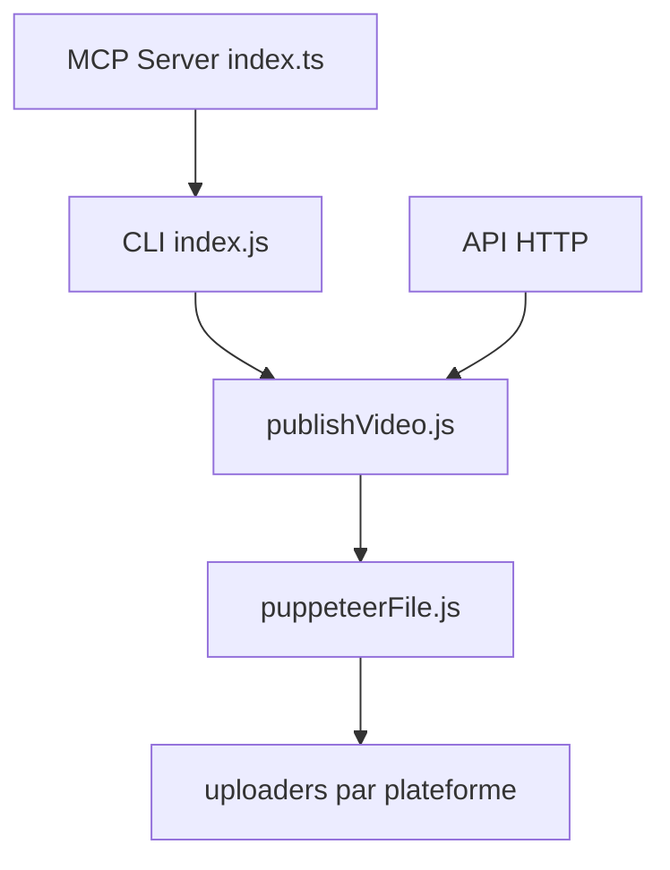

# hanliang97/MatrixMedia

> Electron app and CLI for batch-publishing videos to eight Chinese platforms, controllable by agents.

## The problem
Publishing the same video to several platforms and accounts by hand is slow and repetitive.

## What it actually does
Electron/Vue interface, CLI (`login`, `publish`, `publish-article`, `accounts`, `history`, `stats`), local HTTP API on port 30088 and an MCP server with 7 tools. Uploads are automated through a driven browser (puppeteer) for Douyin, Kuaishou, Bilibili, Xiaohongshu, etc. A real Chrome mode bypasses automation detection.

## How it is wired


## Trying it
```bash
matrixmedia cli login -p dy --phone 13800138000
matrixmedia cli publish -p dy --phone 13800138000 -f /path/to/video.mp4 -t "titre"
matrixmedia cli accounts --json
```

## Cost and gotchas
Free, but platform accounts and cookies are required. The macOS app is unsigned (Gatekeeper). The README is in Chinese and warns against misuse.

## What it is not
Not a tool for Western platforms. It automates sites without an official API: risk of account bans.

## Alternatives
No alternative named in the README.

## For you
Ignore: targets a Chinese content market, fragile by design; only the "CLI + HTTP + MCP" pattern may be inspiring.
