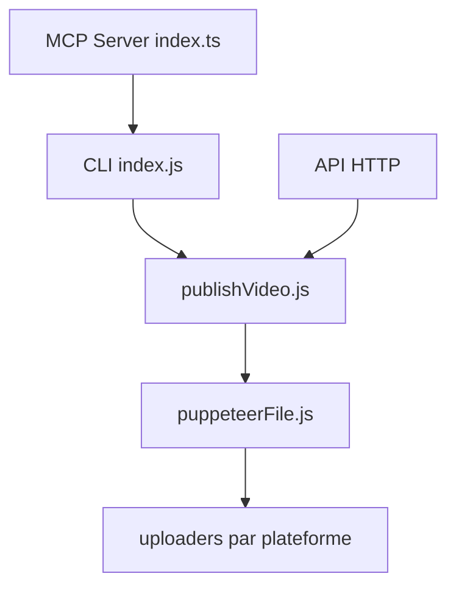

# hanliang97/MatrixMedia

> Application Electron et CLI pour publier des vidéos en lot sur huit plateformes chinoises, pilotable par agents.

## Le problème
Publier la même vidéo sur plusieurs plateformes et comptes à la main est long et répétitif.

## Ce que ça fait vraiment
Interface Electron/Vue, CLI (`login`, `publish`, `publish-article`, `accounts`, `history`, `stats`), API HTTP locale sur le port 30088 et serveur MCP de 7 outils. Les uploads sont automatisés par navigateur piloté (puppeteer) pour Douyin, Kuaishou, Bilibili, Xiaohongshu, etc. Un mode Chrome réel contourne la détection d'automatisation.

## Comment c'est branché


## Essayer
```bash
matrixmedia cli login -p dy --phone 13800138000
matrixmedia cli publish -p dy --phone 13800138000 -f /path/to/video.mp4 -t "titre"
matrixmedia cli accounts --json
```

## Coût et pièges
Gratuit, mais comptes et cookies de plateformes requis. App macOS non signée (Gatekeeper). Le README est en chinois et prévient contre l'usage abusif.

## Ce que ce n'est pas
Pas un outil pour plateformes occidentales. Il automatise des sites sans API officielle : risque de blocage de compte.

## Alternatives
Aucune alternative nommée dans le README.

## Pour toi
À ignorer : cible un marché de contenu chinois, fragile par construction ; seul le patron « CLI + HTTP + MCP » peut inspirer.

