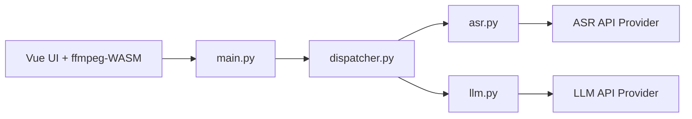

# hanshuaikang/AI-Media2Doc

> Local web app that turns video or audio into styled documents (notes, articles, subtitles) via AI models.

## The problem
Summarizing videos into text to reread them requires tools with an account and payment, which send your content to third parties.

## What it actually does
The browser extracts the audio with ffmpeg WASM, the Python backend calls a speech recognition service then an LLM, produces text in the chosen style (Xiaohongshu, notes, mind map, summary), exports subtitles and allows a chat. Screenshots are placed based on the subtitles, with no vision model. No login; optional access password.

## How it is wired


## Trying it
```bash
docker-compose -f docker-compose.yaml up -d
```
After creating `variables.env` from `variables_template.env`.

## Cost and gotchas
ASR and LLM API keys at your expense (Volcengine-type providers according to the diagram). The README is in Chinese; the last push dates from February 2026.

## What it is not
Not fully local: audio and text go to the providers. Local ASR (fast-whisper) is only planned.

## Alternatives
No alternative named in the README.

## For you
Keep an eye on it: a good ASR → LLM → document pattern, to adapt with a local model; not to adopt as is because of the keys and the language.
