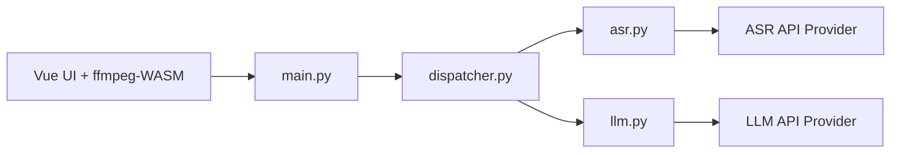

# hanshuaikang/AI-Media2Doc

> Web app locale qui transforme vidéo ou audio en documents stylés (notes, articles, sous-titres) via des modèles IA.

## Le problème
Résumer des vidéos en texte pour les relire demande des outils avec compte et paiement, qui envoient tes contenus à des tiers.

## Ce que ça fait vraiment
Le navigateur extrait l'audio avec ffmpeg WASM, le backend Python appelle un service de reconnaissance vocale puis un LLM, produit un texte au style choisi (Xiaohongshu, notes, carte mentale, résumé), exporte des sous-titres et permet un chat. Les captures sont placées d'après les sous-titres, sans modèle de vision. Aucun login ; mot de passe d'accès optionnel.

## Comment c'est branché


## Essayer
```bash
docker-compose -f docker-compose.yaml up -d
```
Après avoir créé `variables.env` d'après `variables_template.env`.

## Coût et pièges
Clés d'API ASR et LLM à ta charge (fournisseurs de type Volcengine d'après le diagramme). Le README est en chinois ; le dernier push date de février 2026.

## Ce que ce n'est pas
Pas totalement local : audio et texte partent chez les fournisseurs. L'ASR locale (fast-whisper) est seulement planifiée.

## Alternatives
Aucune alternative nommée dans le README.

## Pour toi
Surveiller : bon patron ASR → LLM → document, à adapter avec un modèle local ; pas à adopter tel quel à cause des clés et de la langue.

