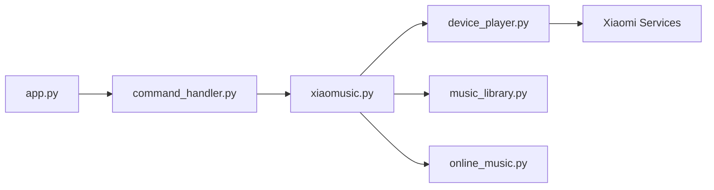

# hanxi/xiaomusic

> Self-hosted music server that plays tracks on Xiaomi Xiao Ai speakers.

## The problem
Xiaomi speakers do not easily play your local or online music by voice command.

## What it actually does
FastAPI server: voice commands (play, next, loop, favorites), web panel, local music (mp3, flac, wav…), downloads via yt-dlp, JSON network playlists, JavaScript plugins. Connects with the Xiaomi account.

## How it is wired


## Trying it
```bash
docker run -p 58090:8090 -v /xiaomusic_music:/app/music -v /xiaomusic_conf:/app/conf hanxi/xiaomusic
pip install -U xiaomusic
xiaomusic
```

## Cost and gotchas
Xiaomi credentials are entered in the interface: the README advises against public access without a password and against linking an account that has cameras. Umami and Sentry are cited among the tools.

## What it is not
Archived project: the author no longer handles issues or PRs, and points to songloft-org/songloft. README in Chinese with advertisements.

## Alternatives
- songloft-org/songloft: community relay cited by the README.

## For you
Ignore: archived, outside the data/AI scope, and it handles the credentials of a personal account.
