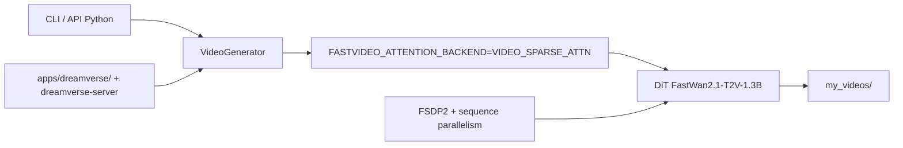

# hao-ai-lab/FastVideo

> Unified post-training and inference framework for GPU video generation.

## The problem
Generating a video with an open DiT costs minutes of denoising per clip.
And every distillation or finetuning recipe lives in a separate repository.

## What it actually does
Full post-training or LoRA on video DiTs, plus a video/image/text preprocessing pipeline.
Step distillation (DMD2) and sparse distillation advertised at more than 50x denoising speedup.
Distributed inference: sequence parallelism, several attention backends, CLI and Python API.
A real-time application, Dreamverse, lives in the monorepo under `apps/dreamverse/` with its server.

## How it is wired


## Trying it
```bash
uv venv --python 3.12 --seed
source .venv/bin/activate
UV_TORCH_BACKEND=cu126 uv pip install fastvideo
python example.py
```

## Cost and gotchas
NVIDIA GPU expected (H100, A100, 4090); on DGX Spark ARM64 the kernel must be compiled from source.
On Apple Silicon, a separate MLX/FastMetal path; weights are downloaded from Hugging Face.

## What it is not
Not a model: it is the machinery around third-party models that you have to download.
Not a tool for use without a GPU — the CPU route is not documented.
The monorepo mixes training, inference and a product app; the surface to read is wide.

## Alternatives
SGLang: its diffusion inference derives from a fork of FastVideo, if you only want to serve.

## For you
Worth a look only if video generation falls within your scope; otherwise off-topic.
