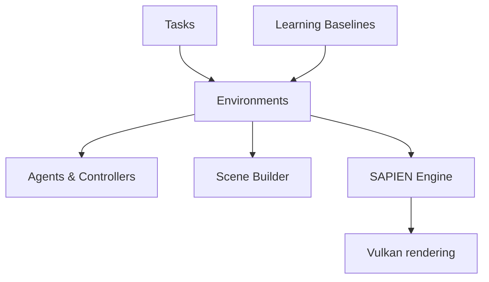

# haosulab/ManiSkill

> GPU robotics simulation framework (SAPIEN) focused on manipulation, with RL and imitation baselines.

## The problem
Generating large amounts of robot manipulation data and training policies requires fast parallel simulation.

## What it actually does
GPU-parallelized simulation and rendering (over 30,000 FPS in RGBD according to the README, on a 4090), heterogeneous environments, tasks for several robots, a task-building API, real2sim environments and sim2real examples. Provides PPO, SAC, TD-MPC2, Diffusion Policy and VLA models.

## How it is wired


## Trying it
```bash
pip install --upgrade mani_skill
pip install torch
```

## Cost and gotchas
Vulkan has to be set up yourself; an NVIDIA GPU for the advertised performance (free Colab possible to try it out). The figures come from the authors.

## What it is not
Not a general-purpose physics simulator: focused on manipulation. The diagram flags a beta status.

## Alternatives
- No alternative named in the README.

## For you
Worth watching: useful for RL or imitation in manipulation; the Colab notebook lets you try it without hardware.
