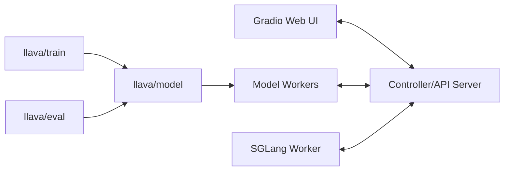

# haotian-liu/LLaVA

> Training, evaluation and serving code for the LLaVA vision-language model.

## The problem
Building a multimodal assistant means aligning a vision encoder with an LLM and then instruction-tuning it on image-text data.

## What it actually does
Two-stage training: alignment (an MLP projector between a frozen CLIP ViT-L/14 and a frozen Vicuna) then instruction tuning.
Serving: controller, Gradio server, model workers (4/8-bit, LoRA, multi-GPU) and an SGLang worker.
CLI inference (`llava.serve.cli`) and evaluation on 12 benchmarks, including a GPT-4-assisted evaluation.
Model Zoo of v1.5 checkpoints; LLaVA-NeXT has its own repository.

## How it is wired


## Trying it
```bash
git clone https://github.com/haotian-liu/LLaVA.git
cd LLaVA
conda create -n llava python=3.10 -y
conda activate llava
pip install -e .
python -m llava.serve.cli --model-path liuhaotian/llava-v1.5-7b --image-file "https://llava-vl.github.io/static/images/view.jpg" --load-4bit
```

## Cost and gotchas
Training on 8×A100 80 GB; 4-bit inference < 8 GB. The GPT evaluation requires an OpenAI key. Licenses of the data and base LLMs must be respected.

## What it is not
Not the latest LLaVA (NeXT lives elsewhere). Repository inactive since August 2024. Linux only for the standard installation.

## Alternatives
- LLaVA-NeXT: stronger successor (separate code).
- Otter, LLaVA-Med: neighboring projects cited.

## For you
Watch: an excellent read for understanding VLM architecture and LoRA fine-tuning, but more recent models have surpassed it for real use.
