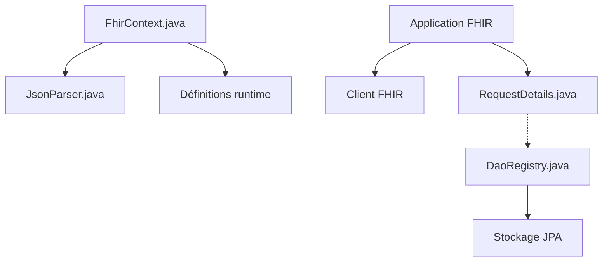

# hapifhir/hapi-fhir

> Java API for building HL7 FHIR clients and servers, a health data exchange standard.

## The problem
Exchanging health records according to FHIR requires handling resources, formats, validation and search without a common framework.

## What it actually does
The README is a pointer to the hapifhir.io site and a demo. According to the architecture: per-version resource models, JSON parsers, validation, FHIRPath, narrative generation, REST client, server requests, JPA storage with search indexes, master data matching, CDS Hooks and bulk export.

## How it is wired

## Trying it
No command documented in the provided README: documentation is on hapifhir.io.

## Cost and gotchas
Free, Apache-2.0. Commercial support exists at Smile CDR. 1,689 open issues: a vast project.

## What it is not
Not a ready-to-use product: a Java library. No detailed functional description in the README.

## Alternatives
No alternative named; Smile CDR is cited for commercial support.

## For you
Watch: a reference if you process FHIR health data in Java; otherwise outside the data / AI scope.
