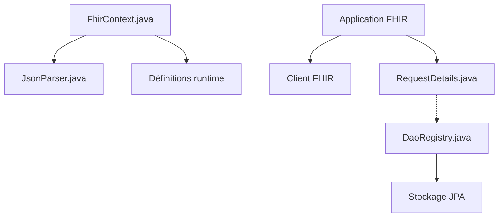

# hapifhir/hapi-fhir

> API Java pour construire des clients et serveurs HL7 FHIR, standard d'échange de données de santé.

## Le problème
Échanger des dossiers de santé selon FHIR demande de gérer ressources, formats, validation et recherche sans cadre commun.

## Ce que ça fait vraiment
Le README est un renvoi vers le site hapifhir.io et une démo. D'après l'architecture : modèles de ressources par version, analyseurs JSON, validation, FHIRPath, génération de narratifs, client REST, requêtes serveur, stockage JPA avec index de recherche, correspondance de données maîtres, CDS Hooks et export en masse.

## Comment c'est branché

## Essayer
Aucune commande documentée dans le README fourni : documentation sur hapifhir.io.

## Coût et pièges
Gratuit, Apache-2.0. Un support commercial existe chez Smile CDR. 1 689 issues ouvertes : projet vaste.

## Ce que ce n'est pas
Pas un produit prêt à l'emploi : une bibliothèque Java. Pas de description fonctionnelle détaillée dans le README.

## Alternatives
Aucune alternative nommée ; Smile CDR est cité pour le support commercial.

## Pour toi
À surveiller : référence si tu traites des données de santé FHIR en Java ; sinon hors périmètre data / IA.

