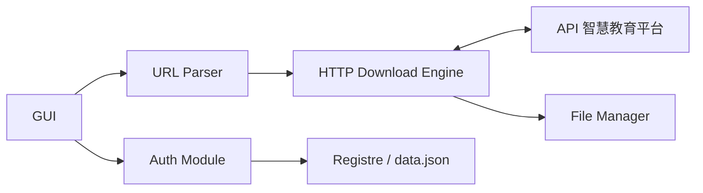

# happycola233/tchMaterial-parser

> Desktop application that batch-downloads PDF textbooks from the Chinese education platform.

## The problem
Textbooks on the Chinese education portal can only be downloaded one at a time from the browser, with no clean file name and no bookmarks.

## What it actually does
You paste one or more textbook page URLs; the tool resolves the PDFs, names them after the textbook title and can add bookmarks. An account Access Token can be entered (retrieved via a script pasted into the browser console); without it, a "non-durable" fallback method is used. Search by level/subject/year, dark mode.

## How it is wired


## Trying it
```bash
winget install happycola233.tchMaterial-parser
yay -S tchmaterial-parser
xattr -cr /path/to/tchMaterial-parser.app
```

## Cost and gotchas
Free. The token expires (about 7 days) and comes from an account on the platform; it is stored locally (Windows registry or `data.json`). A graphical interface is required.

## What it is not
Not a generic download tool: it only serves this portal, depends on its unofficial APIs and on its goodwill. Copyrighted content, personal and educational use only.

## Alternatives
- ChinaTextbook: an archive of already-downloaded textbook PDFs, cited by the README.

## For you
Ignore: no connection to data/AI/MLOps, only useful if you need Chinese school textbooks.
