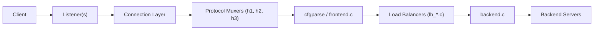

# haproxy/haproxy

> A TCP/HTTP reverse proxy and load balancer in C, for those who operate exposed services.

## The problem
Without a load balancer, a service goes down with its single server and each backend handles TLS, failover and rate limiting on its own.

## What it actually does
It accepts TCP, HTTP/1, HTTP/2 and HTTP/3 (QUIC) connections, applies ACLs, filters and compression, picks a backend according to a balancing algorithm and returns the response. It handles TLS, OCSP and ACME, stick-tables, peer synchronization, a management CLI, statistics and the Lua extension.

## How it is wired

## Trying it
The README gives no command: it refers to the INSTALL file for compilation and to `doc/configuration.txt` for configuration.

## Cost and gotchas
Free. Compilation from source (INSTALL file) or packages listed on the wiki. The configuration is a dense reference to learn. License present but not identified by GitHub: read LICENSE.

## What it is not
Not a data or AI tool: it is network infrastructure. The tracker is not a place for support (forum, mailing list, Slack).

## Alternatives
No alternative named in the README.

## For you
Worth watching: useful upstream of model serving or an API, but it is network operations more than data work.
