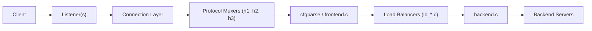

# haproxy/haproxy

> Un reverse-proxy et répartiteur de charge TCP/HTTP en C, pour qui opère des services exposés.

## Le problème
Sans répartiteur, un service tombe avec son unique serveur et chaque backend gère seul TLS, bascule et limitation.

## Ce que ça fait vraiment
Il accepte des connexions TCP, HTTP/1, HTTP/2 et HTTP/3 (QUIC), applique ACL, filtres et compression, choisit un backend selon un algorithme de répartition et renvoie la réponse. Il gère TLS, OCSP et ACME, les stick-tables, la synchronisation entre pairs, une CLI de gestion, des statistiques et l'extension Lua.

## Comment c'est branché

## Essayer
Le README ne donne pas de commande : il renvoie au fichier INSTALL pour la compilation et à `doc/configuration.txt` pour la configuration.

## Coût et pièges
Gratuit. Compilation depuis les sources (fichier INSTALL) ou paquets listés sur le wiki. La configuration est un référentiel dense à apprendre. Licence présente mais non identifiée par GitHub : lire LICENSE.

## Ce que ce n'est pas
Pas un outil de données ou d'IA : c'est de l'infrastructure réseau. Le tracker n'est pas un lieu de support (forum, liste, Slack).

## Alternatives
Aucune alternative nommée dans le README.

## Pour toi
À surveiller : utile en amont d'un serving de modèles ou d'une API, mais relève de l'exploitation réseau plus que du travail data.

