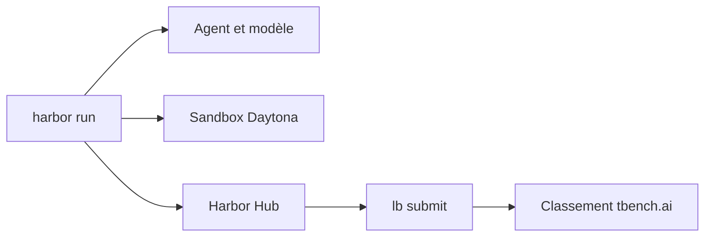

# harbor-framework/terminal-bench-2-1

> Terminal task benchmark to measure AI agents, corrected version 2.1 of Terminal-Bench 2.0.

## The problem
Evaluating agents on realistic command-line tasks requires verified tasks that resist reward hacking.

## What it actually does
A collection of tasks run in containers (proteins, asynchronous code, security flaws). Version 2.1 fixes 26 tasks: bugs, timeouts, resources and robustness to reward hacking. You run it with Harbor, with a cloud sandbox provider such as Daytona, then submit the results to the leaderboard.

## How it is wired
Simplified diagram based on the sheet, no diagram provided.



## Trying it
```bash
uv tool install "harbor[daytona]"
harbor auth login
harbor run -d terminal-bench/terminal-bench-2-1 -a <agent> -m <provider/model> -e <sandbox> -k 5 -n <concurrency> --upload --public
```

## Cost and gotchas
Models and the cloud sandbox are at your expense, and you need a Harbor Hub account. A leaderboard entry requires at least 5 attempts per task. Community submissions are currently closed.

## What it is not
Not an agent nor a training framework: only a set of tasks with an evaluation protocol. The cost of a full run is not documented.

## Alternatives
- Terminal-Bench 2.0: previous version, less verified according to the README.

## For you
Watch: a useful reference to compare terminal coding agents, but costly to replay and mostly readable through the leaderboard.
