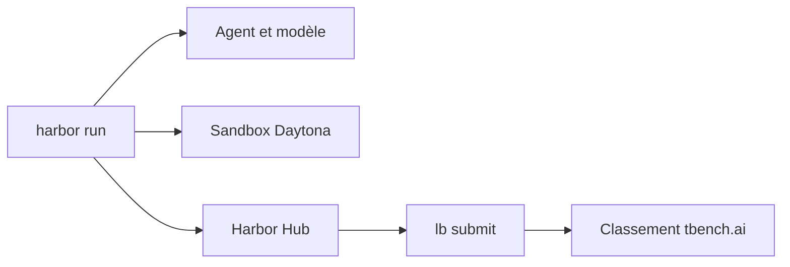

# harbor-framework/terminal-bench-2-1

> Benchmark de tâches en terminal pour mesurer les agents IA, version 2.1 corrigée de Terminal-Bench 2.0.

## Le problème
Évaluer des agents sur des tâches réalistes en ligne de commande demande des tâches vérifiées, résistantes au détournement de la récompense.

## Ce que ça fait vraiment
Collection de tâches exécutées dans des conteneurs (protéines, code asynchrone, failles de sécurité). La version 2.1 corrige 26 tâches : bugs, délais, ressources et robustesse au reward hacking. On l'exécute avec Harbor, avec un fournisseur de sandbox cloud comme Daytona, puis on soumet les résultats au classement.

## Comment c'est branché
Schéma simplifié d'après la fiche, sans diagramme fourni.



## Essayer
```bash
uv tool install "harbor[daytona]"
harbor auth login
harbor run -d terminal-bench/terminal-bench-2-1 -a <agent> -m <provider/model> -e <sandbox> -k 5 -n <concurrency> --upload --public
```

## Coût et pièges
Les modèles et la sandbox cloud sont à ta charge, et il faut un compte Harbor Hub. Un classement exige au moins 5 essais par tâche. Les soumissions de la communauté sont actuellement fermées.

## Ce que ce n'est pas
Pas un agent ni un framework d'entraînement : seulement un jeu de tâches avec protocole d'évaluation. Le coût d'une exécution complète n'est pas documenté.

## Alternatives
- Terminal-Bench 2.0 : version précédente, moins vérifiée selon le README.

## Pour toi
À surveiller : référence utile pour comparer des agents de code en terminal, mais coûteuse à rejouer et surtout lisible via le classement.

