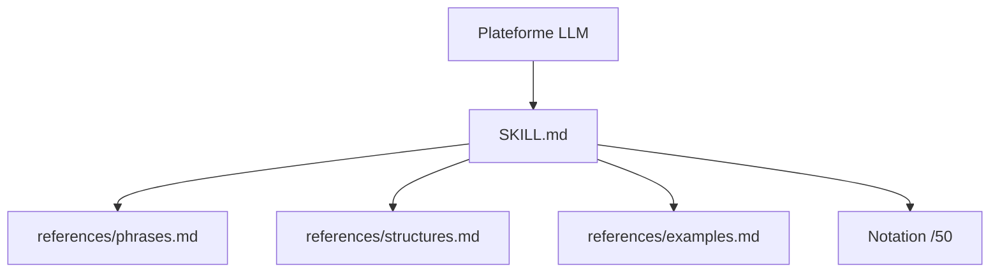

# hardikpandya/stop-slop

> Claude skill that spots and removes the writing tics typical of AI-generated text.

## The problem
Text produced by an LLM is recognizable by its stock phrases, rhythms and predictable structures.

## What it actually does
A bundle of Markdown files: `SKILL.md` gives the instructions, `references/` lists banned phrases, structures to avoid and before/after examples. The model rewrites, then scores itself from 1 to 10 on five criteria; below 35/50 it revises. There is no code and nothing to execute.

## How it is wired

## Trying it
No command: add the folder as a skill in Claude Code, or upload `SKILL.md` and the references into a Claude project, or copy the rules into the custom instructions.

## Cost and gotchas
Free, but it consumes context on every use. The result depends on the model applying the rules.

## What it is not
Not an AI-text detector: it is a rewriting guide. It does not check facts. Banning all adverbs or dashes can impoverish a style.

## Alternatives
No alternative named in the README.

## For you
Worth watching: a simple example of a skill to reread or adapt, but with no technical value of its own for a data or MLOps profile.
