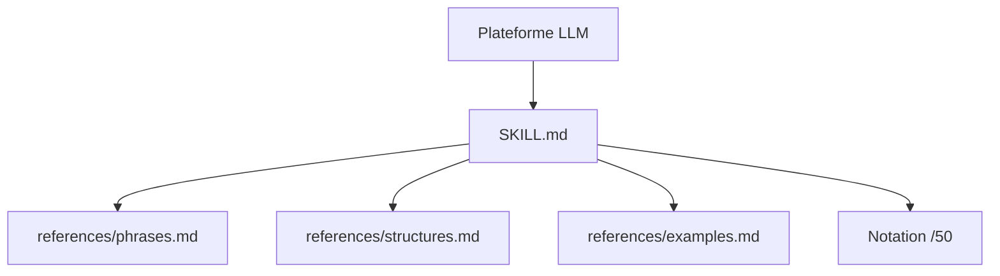

# hardikpandya/stop-slop

> Skill Claude qui repère et retire les tics d'écriture typiques des textes générés par IA.

## Le problème
Les textes produits par un LLM se reconnaissent à leurs formules, leurs rythmes et leurs structures prévisibles.

## Ce que ça fait vraiment
Un paquet de fichiers Markdown : `SKILL.md` donne les consignes, `references/` liste les phrases bannies, les structures à éviter et des exemples avant/après. Le modèle réécrit puis se note de 1 à 10 sur cinq critères ; sous 35/50 il révise. Il n'y a ni code ni exécution.

## Comment c'est branché

## Essayer
Aucune commande : ajouter le dossier comme skill dans Claude Code, ou téléverser `SKILL.md` et les références dans un projet Claude, ou copier les règles dans les instructions personnalisées.

## Coût et pièges
Gratuit, mais consomme du contexte à chaque usage. Le résultat dépend du modèle qui applique les règles.

## Ce que ce n'est pas
Pas un détecteur de texte IA : c'est un guide de réécriture. Il ne vérifie pas les faits. Interdire tous les adverbes ou tirets peut appauvrir un style.

## Alternatives
Aucune alternative nommée dans le README.

## Pour toi
À surveiller : exemple simple de skill à relire ou adapter, mais sans valeur technique propre pour un profil data ou MLOps.

