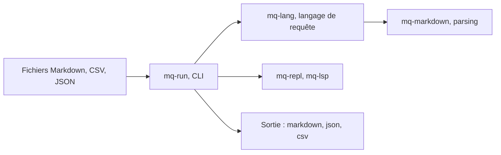

# harehare/mq

> Command-line tool, written in Rust, to query and transform Markdown the way jq does for JSON.

## The problem
Extracting a section, links or code blocks from Markdown files means cobbling together grep or scripts.

## What it actually does
mq applies a jq-like syntax to Markdown documents: selectors for headings, code, links, filters and functions. It also reads MDX, HTML, CSV, JSON, YAML or TOML and writes several formats. It offers a REPL, a language server, an experimental debugger and Python, Go, Ruby, Java bindings.

## How it is wired


## Trying it
```bash
curl -sSL https://mqlang.org/install.sh | bash
mq '.h' README.md
mq '.code("rust")' example.md
mq -A 'section::section("Installation")' README.md
mq conv report.xlsx | mq '.h'
```

## Cost and gotchas
Free. File reading and writing, network and command execution are disabled by default and enabled through options. The piped-script installation should be reviewed before use.

## What it is not
Not an editor or a Markdown rendering engine. The project is announced as under active development, so the syntax may change.

## Alternatives
No alternative named in the README.

## For you
Adopt it to prepare or split Markdown corpora intended for LLMs: single binary, MIT license, simple installation.
