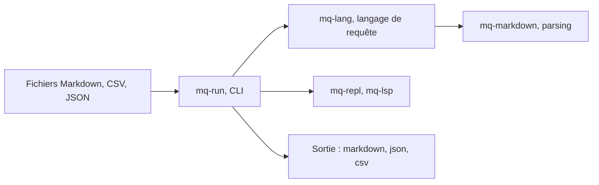

# harehare/mq

> Outil en ligne de commande, écrit en Rust, pour interroger et transformer du Markdown comme jq le fait pour JSON.

## Le problème
Extraire une section, des liens ou des blocs de code dans des fichiers Markdown oblige à bricoler du grep ou des scripts.

## Ce que ça fait vraiment
mq applique une syntaxe proche de jq à des documents Markdown : sélecteurs de titres, de code, de liens, filtres et fonctions. Il lit aussi MDX, HTML, CSV, JSON, YAML ou TOML et écrit dans plusieurs formats. Il propose un REPL, un serveur de langage, un débogueur expérimental et des liaisons Python, Go, Ruby, Java.

## Comment c'est branché


## Essayer
```bash
curl -sSL https://mqlang.org/install.sh | bash
mq '.h' README.md
mq '.code("rust")' example.md
mq -A 'section::section("Installation")' README.md
mq conv report.xlsx | mq '.h'
```

## Coût et pièges
Gratuit. Lecture et écriture de fichiers, réseau et exécution de commandes sont désactivés par défaut et s'activent par options. L'installation par script piped est à relire avant usage.

## Ce que ce n'est pas
Pas un éditeur ni un moteur de rendu Markdown. Le projet est annoncé en développement actif, donc la syntaxe peut bouger.

## Alternatives
Aucune alternative nommée dans le README.

## Pour toi
À adopter pour préparer ou découper des corpus Markdown destinés à des LLM : binaire unique, licence MIT, installation simple.

