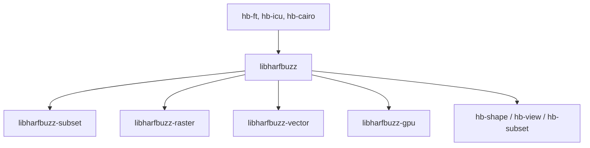

# harfbuzz/harfbuzz

> Text shaping engine and font platform, for graphics-system developers.

## The problem
Correctly displaying complex scripts (Arabic, Indic) requires applying OpenType rules to glyphs.

## What it actually does
`libharfbuzz` shapes text, `libharfbuzz-subset` shrinks fonts. Companion libraries rasterize, produce SVG or encode glyphs for the GPU. Command-line tools (`hb-shape`, `hb-view`, `hb-subset`, `hb-info`) are provided.

## How it is wired


## Trying it
```bash
# Le README renvoie à BUILD.md pour la compilation ;
# aucune commande n'y figure. Essai en ligne : harfbuzz-world.cc
```

## Cost and gotchas
Free. Building goes through BUILD.md, which was not provided. No font hinting: FreeType or Skrifa is needed for that. License present in COPYING but not identified by GitHub.

## What it is not
It is not a complete rendering engine: hinting is missing. Nor is it a ready-to-use tool for end users.

## Alternatives
- FreeType or Skrifa: for rasterization with hinting.
- uharfbuzz: for use from Python.

## For you
Ignore: a typography building block already embedded in browsers and operating systems, rarely handled directly in data / AI / MLOps.
