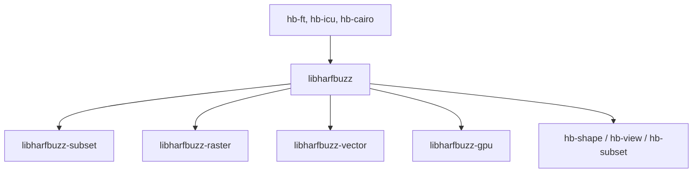

# harfbuzz/harfbuzz

> Moteur de mise en forme de texte et plateforme de polices, pour développeurs de systèmes graphiques.

## Le problème
Afficher correctement des scripts complexes (arabe, indic) demande d'appliquer les règles OpenType aux glyphes.

## Ce que ça fait vraiment
`libharfbuzz` met en forme le texte, `libharfbuzz-subset` réduit les polices. Des bibliothèques annexes rastérisent, produisent du SVG ou encodent les glyphes pour le GPU. Des outils en ligne de commande (`hb-shape`, `hb-view`, `hb-subset`, `hb-info`) sont fournis.

## Comment c'est branché


## Essayer
```bash
# Le README renvoie à BUILD.md pour la compilation ;
# aucune commande n'y figure. Essai en ligne : harfbuzz-world.cc
```

## Coût et pièges
Gratuit. La compilation passe par BUILD.md, non fourni. Pas de hinting de polices : il faut FreeType ou Skrifa pour cela. Licence présente dans COPYING mais non identifiée par GitHub.

## Ce que ce n'est pas
Ce n'est pas un moteur de rendu complet : le hinting manque. Ce n'est pas non plus un outil prêt à l'emploi pour des utilisateurs finaux.

## Alternatives
- FreeType ou Skrifa : pour la rastérisation avec hinting.
- uharfbuzz : pour l'usage depuis Python.

## Pour toi
À ignorer : brique de typographie déjà embarquée dans les navigateurs et systèmes, rarement à manipuler en data / IA / MLOps.

