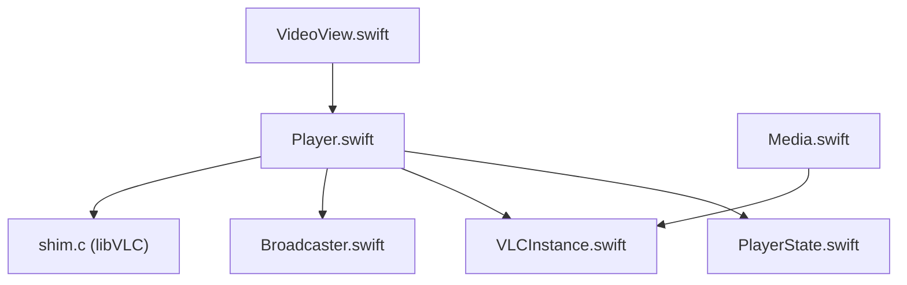

# harflabs/SwiftVLC

> Swift 6 wrapper around libVLC 4.0, for playing exotic formats in Apple apps.

## The problem
AVFoundation plays neither MKV, nor SSA/ASS subtitles, nor SMB or UPnP; VLCKit is in Objective-C and relies on KVO and delegates.

## What it actually does
Calls libVLC's C API directly from Swift. An observable `Player` (SwiftUI), `VideoView(player)`, `AsyncStream` event streams, typed errors, 10-band equalizer, iOS PiP, 360° video, thumbnails, playlists. Targets: iOS, macOS, tvOS, visionOS, Mac Catalyst.

## How it is wired


## Trying it
```bash
swift test
./scripts/setup-dev.sh
```
As a package: `.package(url: "https://github.com/harflabs/SwiftVLC.git", from: "1.0.0")`.

## Cost and gotchas
Free. Swift 6.3+ and Xcode 26.4+. The libVLC xcframework is a large binary (hundreds of MB zipped). Rebuilding libVLC requires about 100 GiB.

## What it is not
It is not a ready-to-use player nor a cross-platform tool outside Apple.

## Alternatives
- VLCKit: VideoLAN's Objective-C wrapper, compared in the README.

## For you
Ignore: Apple app development, unrelated to data / AI.
