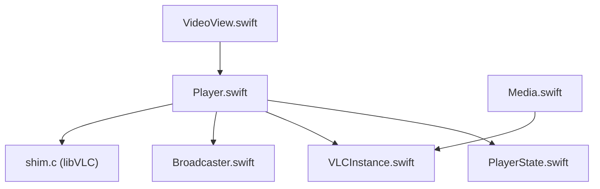

# harflabs/SwiftVLC

> Wrapper Swift 6 autour de libVLC 4.0, pour lire des formats exotiques dans des apps Apple.

## Le problème
AVFoundation ne lit ni MKV, ni sous-titres SSA/ASS, ni SMB ou UPnP ; VLCKit est en Objective-C et suit KVO et delegates.

## Ce que ça fait vraiment
Appelle directement l'API C de libVLC depuis Swift. Un `Player` observable (SwiftUI), `VideoView(player)`, flux d'événements `AsyncStream`, erreurs typées, égaliseur 10 bandes, PiP iOS, vidéo 360°, miniatures, listes de lecture. Cibles : iOS, macOS, tvOS, visionOS, Mac Catalyst.

## Comment c'est branché


## Essayer
```bash
swift test
./scripts/setup-dev.sh
```
En package : `.package(url: "https://github.com/harflabs/SwiftVLC.git", from: "1.0.0")`.

## Coût et pièges
Gratuit. Swift 6.3+ et Xcode 26.4+. Le xcframework libVLC est un gros binaire (centaines de Mo en zip). Reconstruire libVLC demande environ 100 Gio.

## Ce que ce n'est pas
Ce n'est pas un lecteur prêt à l'emploi ni un outil multiplateforme hors Apple.

## Alternatives
- VLCKit : le wrapper Objective-C de VideoLAN, comparé dans le README.

## Pour toi
À ignorer : développement d'apps Apple, sans rapport avec data / IA.

