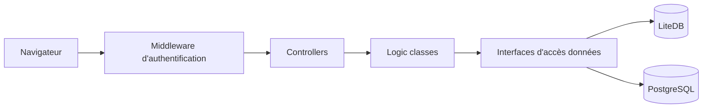

# hargata/lubelog

> Self-hosted web application for tracking vehicle maintenance and fuel consumption.

## The problem
Maintenance logs kept in spreadsheets or loose invoices lose the history and the reminders.

## What it actually does
An ASP.NET Core MVC application: records (fuel, maintenance, odometer, reminders), charts, CSV import, reminder e-mails (SMTP), authentication including OpenID Connect. Data is stored in LiteDB (file) or PostgreSQL. Distributed as a Docker image or Windows executable, with a Helm chart provided by a third party (Anza-Labs).

## How it is wired

## Trying it
The README provides no command: it points to an external getting-started guide. An online demo exists (credentials "test" / "1234", reset every 20 minutes).

## Cost and gotchas
Free; SMTP is needed for e-mail reminders. The README is very short, installation details are outside the repository.

## What it is not
Not a professional fleet management tool nor a data solution: it is a personal tracking application.

## Alternatives
No alternative named in the README.

## For you
Ignore: a consumer application unrelated to data, AI or MLOps work.
