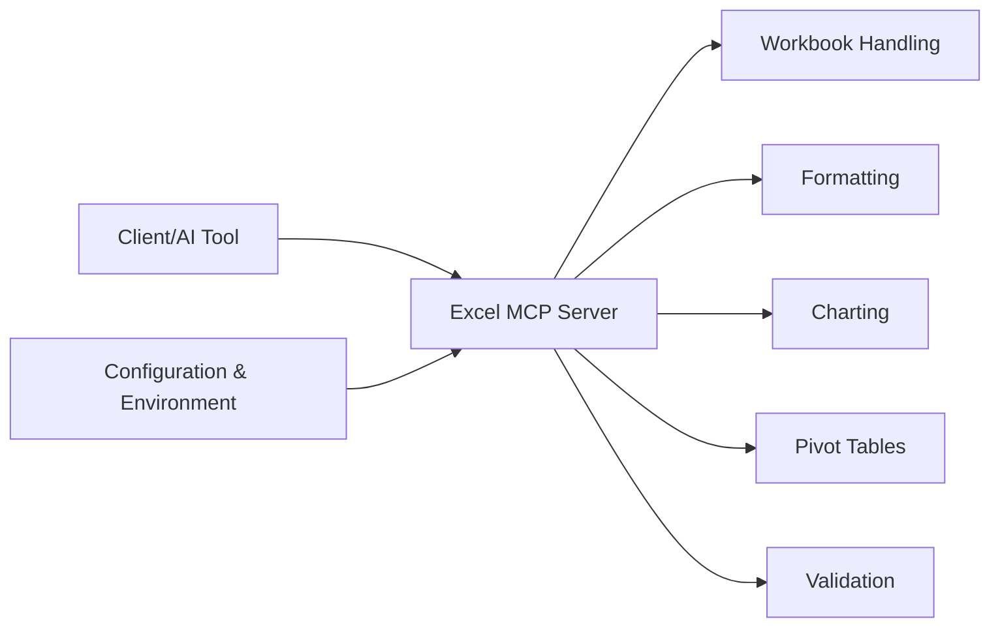

# haris-musa/excel-mcp-server

> MCP server that lets an agent create, read and edit Excel workbooks without installing Excel.

## The problem
An AI assistant can talk about spreadsheets but cannot open an `.xlsx`. Without a tool, the human copies and pastes the data.

## What it actually does
The server exposes MCP tools for workbooks and sheets: reading and writing data, formulas, formatting, tables, charts, pivot tables, validation, copying or deleting sheets. Three transports: stdio (local), SSE (deprecated) and streaming HTTP (`streamable-http`). Judging by the code, each domain has its own module (`chart.py`, `pivot.py`, `formatting.py`, `validation.py`…) behind `server.py`.

## How it is wired


## Trying it
```bash
uvx excel-mcp-server stdio
uvx excel-mcp-server streamable-http
EXCEL_FILES_PATH=/path/to/excel_files FASTMCP_PORT=8007 uvx excel-mcp-server streamable-http
```

## Cost and gotchas
Free. With SSE or HTTP, you must set `EXCEL_FILES_PATH` on the server side; paths are relative to that folder and absolute paths are rejected. The README states port 8017 as the default but its connection examples point to 8000: set `FASTMCP_PORT` explicitly.

## What it is not
It is not Excel: no recalculation by the Excel engine, and no macros. The README does not specify the output format of computed formulas. There is a single maintainer and the project has 73 open issues.

## Alternatives
No alternative named in the README.

## For you
Worth adopting to connect an agent to reporting workbooks: setup is a single `uvx` line, and the risk is limited to the folder of files you designate.
