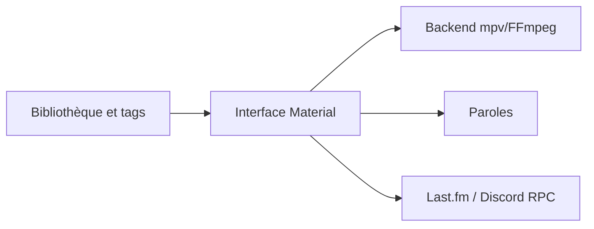

# harmonoid/harmonoid

> Cross-platform music player and library manager with Material design, for individuals.

## The problem
Desktop music players are either ugly, incomplete on formats and tags, or heavy (Electron).

## What it actually does
Player for Windows, Linux, macOS, Android and iOS, with library, tag editor, lyrics (LRC, tags, online), playlists, gapless playback, crossfade, ReplayGain, Last.fm and Discord integrations. The mpv/FFmpeg backend plays all formats. The installer weighs about 35 MB.

## How it is wired

Simplified diagram based on the sheet, no diagram provided.

## Trying it
```bash
# Aucune commande dans le README : télécharger l'installateur depuis le site (lien Download).
```

## Cost and gotchas
Free. No technical prerequisites. The license is not identified by GitHub: read it before any reuse of the code.

## What it is not
It is not a data or AI work tool: it is a consumer application. The README describes neither governance nor architecture.

## Alternatives
No alternative named in the README.

## For you
Ignore: a music player, unrelated to a data, AI or MLOps job, with an unclear license.
