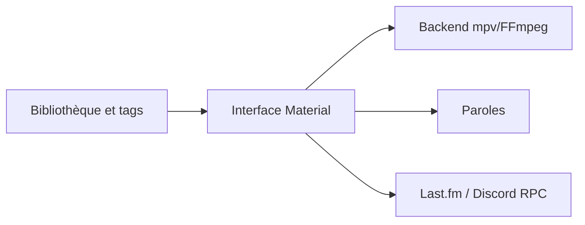

# harmonoid/harmonoid

> Lecteur et gestionnaire de bibliothèque musicale multiplateforme au design Material, pour particuliers.

## Le problème
Les lecteurs de musique de bureau sont soit laids, soit incomplets sur les formats et les tags, soit lourds (Electron).

## Ce que ça fait vraiment
Lecteur pour Windows, Linux, macOS, Android et iOS, avec bibliothèque, éditeur de tags, paroles (LRC, tags, en ligne), playlists, lecture sans coupure, crossfade, ReplayGain, intégrations Last.fm et Discord. Le backend mpv/FFmpeg lit tous les formats. L'installateur pèse environ 35 Mo.

## Comment c'est branché

Schéma simplifié d'après la fiche, sans diagramme fourni.

## Essayer
```bash
# Aucune commande dans le README : télécharger l'installateur depuis le site (lien Download).
```

## Coût et pièges
Gratuit. Aucun prérequis technique. La licence n'est pas identifiée par GitHub : à lire avant toute réutilisation du code.

## Ce que ce n'est pas
Ce n'est pas un outil de travail data ou IA : c'est une application grand public. Le README ne décrit ni la gouvernance ni l'architecture.

## Alternatives
Aucune alternative nommée dans le README.

## Pour toi
À ignorer : un lecteur de musique, sans lien avec un métier data, IA ou MLOps, et à la licence floue.

