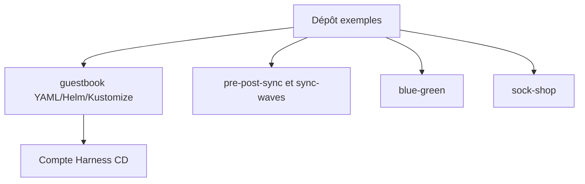

# harness-community/harnesscd-example-apps

> Example applications to demonstrate Harness CD and GitOps, to fork in order to learn the platform.

## The problem
To try Harness CD, you need deployable applications covering several configuration tools.

## What it actually does
Groups variants of a guestbook app: plain YAML, ksonnet, Helm, jsonnet, Kustomize. Adds demos of PreSync/PostSync hooks, sync waves, blue-green, sock-shop and plugins. No instructions in the README.

## How it is wired


## Trying it
```bash
# Aucune commande documentée dans le README
```

## Cost and gotchas
A Harness account is required (offer not detailed in the README). License not declared in the catalog.

## What it is not
Not a tool: only examples. No step-by-step tutorial in the README.

## Alternatives
None named in the README.

## For you
Ignore: examples tied to a specific SaaS, useful only if you are evaluating Harness CD.
