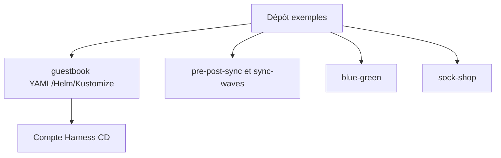

# harness-community/harnesscd-example-apps

> Applications d'exemple pour démontrer Harness CD et GitOps, à forker pour apprendre la plateforme.

## Le problème
Pour essayer Harness CD, il faut des applications déployables couvrant plusieurs outils de configuration.

## Ce que ça fait vraiment
Regroupe des variantes d'une appli guestbook : YAML brut, ksonnet, Helm, jsonnet, Kustomize. Ajoute des démos de hooks PreSync/PostSync, sync waves, blue-green, sock-shop et plugins. Aucun mode d'emploi dans le README.

## Comment c'est branché


## Essayer
```bash
# Aucune commande documentée dans le README
```

## Coût et pièges
Un compte Harness est nécessaire (offre non détaillée dans le README). Licence non déclarée dans le catalogue.

## Ce que ce n'est pas
Pas un outil : seulement des exemples. Pas de tutoriel pas à pas dans le README.

## Alternatives
Aucune nommée dans le README.

## Pour toi
Ignorer : exemples liés à un SaaS précis, utiles seulement si tu évalues Harness CD.

