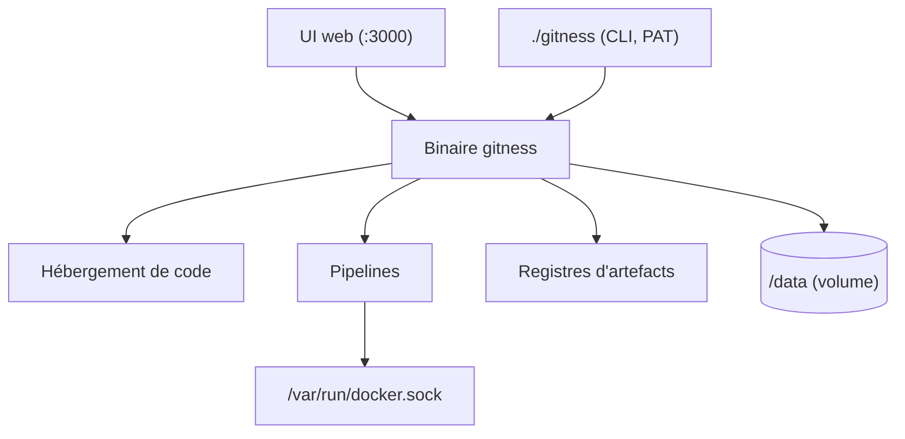

# harness/harness

> Open-source DevOps platform: code hosting, pipelines, Gitspaces and registries.

## The problem
Assembling a Git forge, CI, development environments and an artifact registry otherwise means
four products to integrate, authenticate and maintain separately.

## What it actually does
Brings together in a single binary code repository hosting, automated DevOps pipelines, hosted
development environments (Gitspaces) and artifact registries.
Pipelines run in Docker containers: the Docker API version is negotiated
automatically with the daemon, which covers Docker Desktop, Rancher Desktop, Colima and native Docker.
Exposes a web interface on port 3000, a Swagger specification at `/swagger`, a separate
Swagger for registries, and a `gitness` CLI to create personal access tokens.

## How it is wired


## Trying it
```bash
docker run -d -p 3000:3000 -p 3022:3022 \
  -v /var/run/docker.sock:/var/run/docker.sock \
  -v /tmp/harness:/data --name harness --restart always harness/harness
make dep && make tools
make build
./gitness server .local.env
./gitness login          # user: admin, pw: changeit
```

## Cost and gotchas
Free. The container mounts the host's Docker socket, which gives the service extensive power
over the machine. Without a named volume or bind mount, all data disappears on shutdown.
The initial password is `changeit`. Building requires Node, Go >= 1.20 and protobuf at exactly
v3.21.11, with a pinned Homebrew recipe.

## What it is not
It is not Drone, and does not match it yet: the README announces pipeline capability parity as a goal
to reach, with Drone frozen in a branch. It is not the commercial Harness
platform: it is the open-source edition. The CLI is described as "VERY basic".

## Alternatives
- **Drone**: the ancestor, kept in the `drone` branch, more mature for pipelines alone.

## For you
Worth watching if you want a self-hosted forge and CI all in one for your projects.
