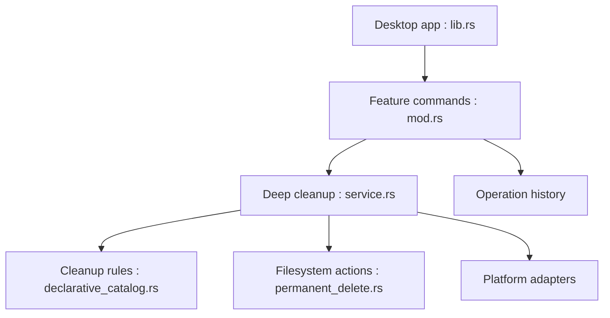

# harry0703/MangoDisk

> Desktop app for disk cleanup, privacy and system maintenance, with a CLI.

## The problem
Caches, build artifacts, AI models and duplicates take up space, and it is hard to know what is safe to delete.

## What it actually does
A read-only scan lists system and application caches, browsers, developer tools, Docker containers, project artifacts (Node, Rust, Python…) and local AI models. It also offers large files, duplicates, treemap analysis, uninstallation, startup items and an operation history. Nothing is deleted without confirmation, and its cleanup rules are published. AI explanations are offered, with a free daily quota or your own service.

## How it is wired


## Trying it
```bash
mangodisk --version
mangodisk clean
mangodisk clean --apply --selection all --dry-run
mangodisk clean --format json --no-progress
```

## Cost and gotchas
Free. The README's `curl | bash` and `irm | iex` installers run a remote script: read it first. Deletions can be irreversible; back up beforehand. Recent project (August 2026), GPL-3.0 license.

## What it is not
It is not an AI tool: the AI only comments on the items. No prebuilt Linux CLI binary.

## Alternatives
No alternative named in the README.

## For you
Worth watching: useful for reclaiming space taken by Docker caches, environments and local models, but young and best tested on a test folder first.
