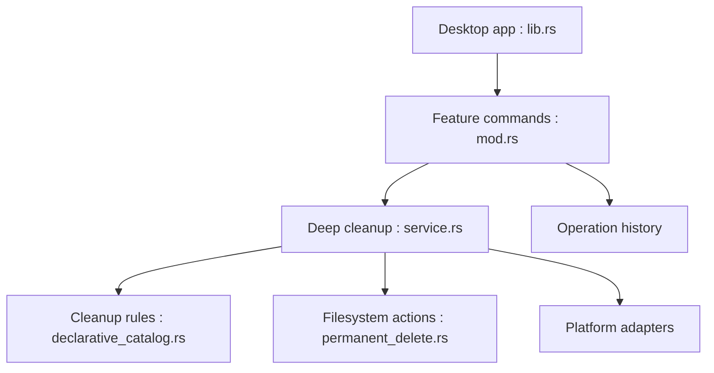

# harry0703/MangoDisk

> Application bureau de nettoyage disque, de confidentialité et de maintenance système, avec une CLI.

## Le problème
Les caches, artefacts de build, modèles d'IA et doublons occupent de l'espace sans qu'on sache quoi supprimer sans risque.

## Ce que ça fait vraiment
Un scan en lecture seule recense caches système et applicatifs, navigateurs, outils de développement, conteneurs Docker, artefacts de projets (Node, Rust, Python…) et modèles d'IA locaux. Il propose aussi gros fichiers, doublons, analyse en treemap, désinstallation, éléments de démarrage et historique des opérations. Rien n'est supprimé sans confirmation, et ses règles de nettoyage sont publiées. Des explications par IA sont proposées, avec quota gratuit quotidien ou ton propre service.

## Comment c'est branché


## Essayer
```bash
mangodisk --version
mangodisk clean
mangodisk clean --apply --selection all --dry-run
mangodisk clean --format json --no-progress
```

## Coût et pièges
Gratuit. Les installeurs `curl | bash` et `irm | iex` du README exécutent un script distant : relis-le d'abord. Les suppressions peuvent être irréversibles ; sauvegarde avant. Projet récent (août 2026), licence GPL-3.0.

## Ce que ce n'est pas
Ce n'est pas un outil d'IA : l'IA ne fait que commenter les éléments. Pas de binaire CLI Linux préconstruit.

## Alternatives
Aucune alternative nommée dans le README.

## Pour toi
À surveiller : utile pour récupérer de l'espace pris par caches Docker, environnements et modèles locaux, mais jeune et à tester sur un dossier de test d'abord.

