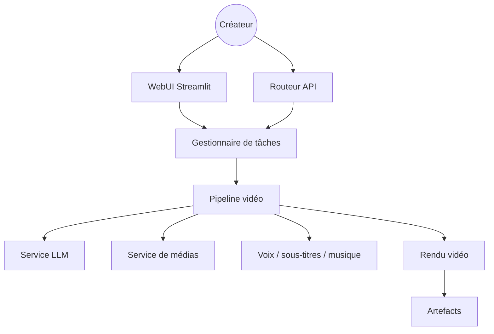

# harry0703/MoneyPrinterTurbo

> Automatic video generator that creates short videos from a given topic, including a script, voiceover, subtitles, and editing.

## The problem
Creating a short video requires a script, a stock image library, voice-over narration, subtitles, music, and editing.
Each step has its own tools and formats; doing them manually would take hours.

## What it actually does
Starting from a theme, generate the script, extract keywords, create or generate plans, and assemble everything.
Four input methods: AI agent, Streamlit WebUI, FastAPI API, and CLI – with batch generation.
Voice via Edge TTS (free, no key required) or a dozen cloud services; subtitles via TTS timestamps or faster-whisper.
Three output formats (9:16, 16:9, 1:1) and automatic publication to TikTok, Instagram, and YouTube Shorts.

## How it is wired


## Trying it
```shell
git clone https://github.com/harry0703/MoneyPrinterTurbo.git
cd MoneyPrinterTurbo
docker compose -f docker-compose.release.yml up
uv run python cli.py --video-subject "人工智能如何改变日常生活"
```

## Cost and gotchas
LLMs, cloud-based voice services, and AI-powered video generation are all offered and priced by providers.

Whisper local downloads a model that ranges from 1.6 to 3 GB; ffmpeg may sometimes need to be installed manually.

## What it is not
Not a production tool: no fine-grained control over tempo, transitions, or color grading.
The README is full of sponsored links to API vendors – to be read as advertising.
The background music is sourced from YouTube, with an explicit disclaimer regarding copyright in case of dispute.

## Alternatives
- `openai/whisper`: if only transcription is needed.

## For you
Outside the data/AI scope, and the reliance on the API vendors mentioned is a concerning sign. Should be disregarded.
