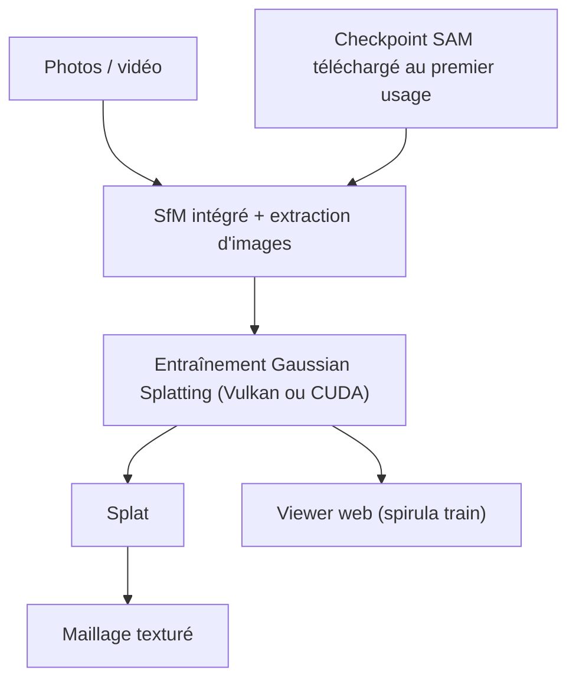

# harry7557558/spirula-studio

> Standalone application that trains 3D Gaussian Splatting models from photos or videos, on any GPU.

## The problem
Training a Gaussian Splatting usually requires Python, PyTorch and a separate COLMAP installation, often restricted to NVIDIA cards.

## What it actually does
A single binary goes from raw photos or videos to the splat, then to the textured mesh. It integrates structure from motion (SfM), AI masking and frame extraction from videos. It runs through Vulkan on NVIDIA, AMD, Intel and Apple, and handles fisheye and 360° cameras. According to the README, 10 million gaussians fit in 8 GB of VRAM.

## How it is wired
Simplified diagram based on the sheet, no diagram provided.



## Trying it
```bash
spirula --help
cd spirula-studio/
bash build_develop.bash -DSS_BACKEND=vulkan -DSS_ENABLE_PATENTED=ON
```

## Cost and gotchas
Free, but a Vulkan-compatible (or CUDA) GPU is required. The `-DSS_ENABLE_PATENTED=ON` option enables AVC/HEVC video decoding on the GPU: you are responsible for complying with local patents. The SAM 3 checkpoint is under a non-standard Meta license.

## What it is not
It is not a Python library: no PyTorch, no API for your code. The project is maintained almost entirely by one person, who sometimes answers late. The GPL-3.0 license requires derivatives to be shared.

## Alternatives
No alternative named in the README.

## For you
Worth watching if you do 3D reconstruction: all-in-one and multi-GPU, but maintained by a single person and under GPL-3.0.
