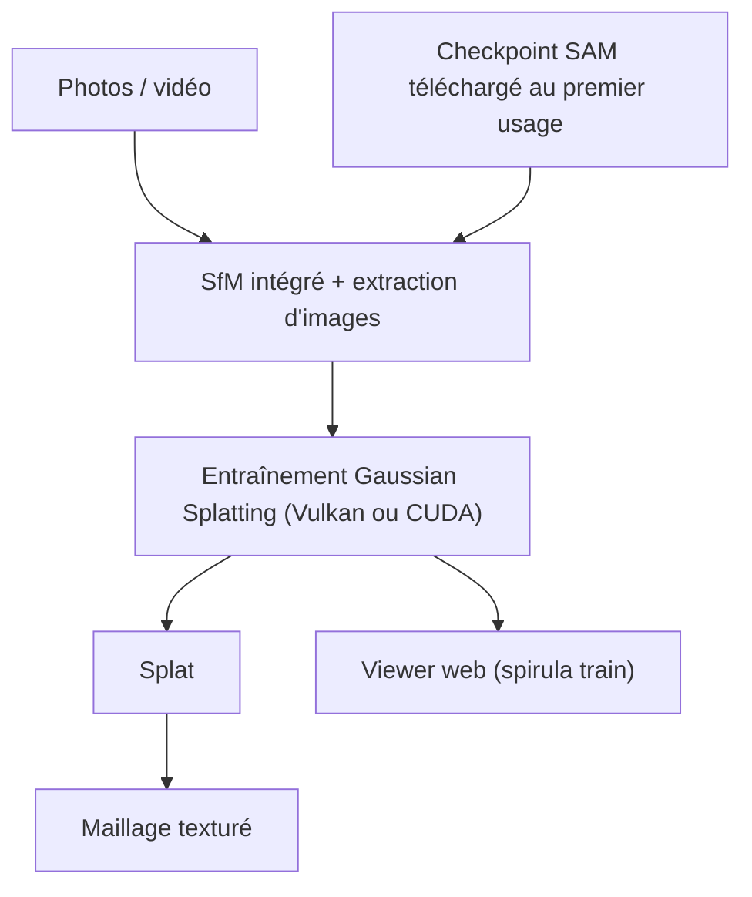

# harry7557558/spirula-studio

> Application autonome qui entraîne des modèles de Gaussian Splatting 3D à partir de photos ou de vidéos, sur tout GPU.

## Le problème
Entraîner un Gaussian Splatting demande d'ordinaire Python, PyTorch et une installation séparée de COLMAP, souvent réservée aux cartes NVIDIA.

## Ce que ça fait vraiment
Un seul binaire va des photos ou vidéos brutes au splat, puis au maillage texturé. Il intègre la structure à partir du mouvement (SfM), le masquage par IA et l'extraction d'images de vidéos. Il tourne via Vulkan sur NVIDIA, AMD, Intel et Apple, et gère les caméras fisheye et 360°. Selon le README, 10 millions de gaussiennes tiennent dans 8 Go de VRAM.

## Comment c'est branché
Schéma simplifié d'après la fiche, sans diagramme fourni.



## Essayer
```bash
spirula --help
cd spirula-studio/
bash build_develop.bash -DSS_BACKEND=vulkan -DSS_ENABLE_PATENTED=ON
```

## Coût et pièges
Gratuit, mais il faut un GPU compatible Vulkan (ou CUDA). L'option `-DSS_ENABLE_PATENTED=ON` active le décodage vidéo AVC/HEVC sur GPU : tu es responsable du respect des brevets locaux. Le checkpoint SAM 3 est sous une licence Meta non standard.

## Ce que ce n'est pas
Ce n'est pas une bibliothèque Python : pas de PyTorch, pas d'API pour ton code. Le projet est maintenu presque entièrement par une personne, qui répond parfois tard. La licence GPL-3.0 impose le partage des dérivés.

## Alternatives
Aucune alternative nommée dans le README.

## Pour toi
À surveiller si tu fais de la reconstruction 3D : tout-en-un et multi-GPU, mais maintenu par une seule personne et sous GPL-3.0.

