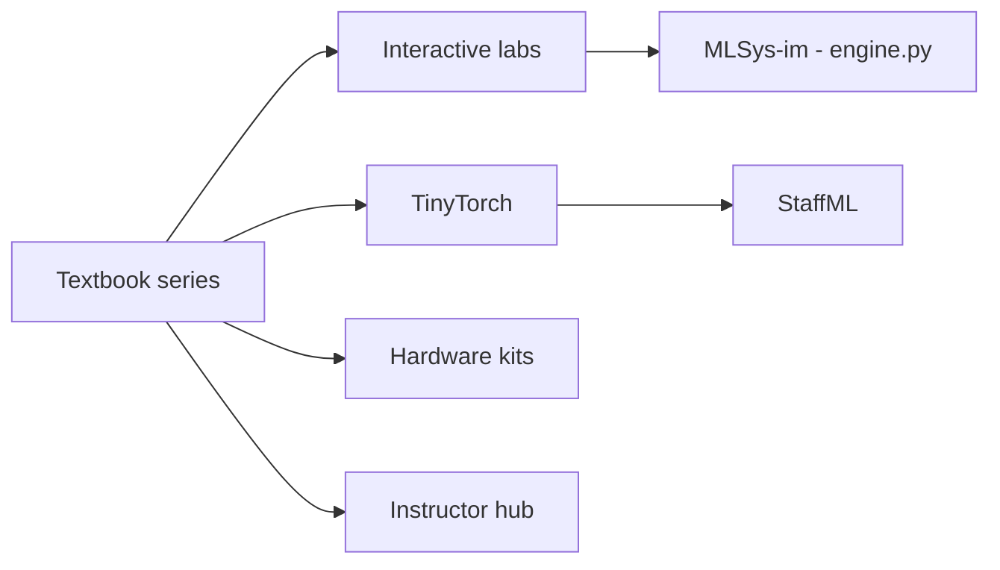

# harvard-edge/cs249r_book

> Open multi-volume textbook on ML systems engineering, with labs, TinyTorch and hardware kits.

## The problem
Deep learning courses stop at the model; few teach running on real hardware, at scale and under latency and power constraints.

## What it actually does
A curriculum: a four-volume textbook (I Foundations, II Scaling in preview, III Agentic and IV Physical AI in development), interactive Marimo labs, TinyTorch (rebuild a framework in 20 modules), hardware kits (Arduino, Raspberry Pi…), the MLSys·im simulator, StaffML interview questions, resources for instructors. Free to read at mlsysbook.ai.

## How it is wired

## Trying it
The README gives no command; it directs you to read volume I online, lab 00 and TinyTorch.

## Cost and gotchas
Free online. Volumes III and IV change fast. The text is under CC BY-NC-SA 4.0 (non-commercial use); each tool has its own license. `dev` branch for active development.

## What it is not
Not a recipe-based MLOps course: the README insists on the physics and quantitative reasoning beneath the tools. Not a deep learning textbook.

## Alternatives
No alternative named as a direct equivalent (the README cites deep learning books as complementary).

## For you
Worth watching: excellent reading for understanding memory, KV-cache and infrastructure, but the non-commercial clause and still-shifting volumes are drawbacks.
