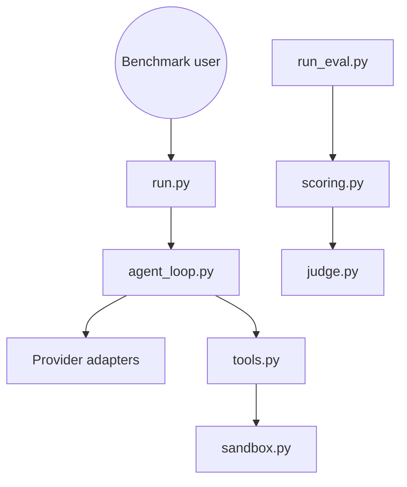

# harveyai/harvey-labs

> Open benchmark for evaluating LLM agents on realistic legal tasks, for evaluation teams.

## The problem
Evaluating agents on real legal work (case files, documents, deliverables) lacks task sets with realistic grading rubrics.

## What it actually does
Two parts: a task set (instructions, documents, rubrics) and an execution harness. `run.py` loads a task and launches an agent loop through a provider adapter, with workspace tools in a sandbox and a document parser. An evaluator scores by "all-pass" rubric with an LLM judge, and produces reports, comparisons, charts, trajectory reading and model sweeps.

## How it is wired

## Trying it
No command in the provided README; it points to `docs/tutorial.md` (end-to-end M&A walkthrough: installation, execution, scoring, reports).

## Cost and gotchas
Calls to the model providers and to the LLM judge are at your expense; the cost of a sweep is not documented in the material provided.

## What it is not
Not a usable legal agent: it is a test bench. The project is announced as evolving, with tasks and harness under construction.

## Alternatives
None cited in the README.

## For you
Watch: interesting as a methodological model (all-pass rubrics + LLM judge) for evaluating agents, even outside the legal field.
