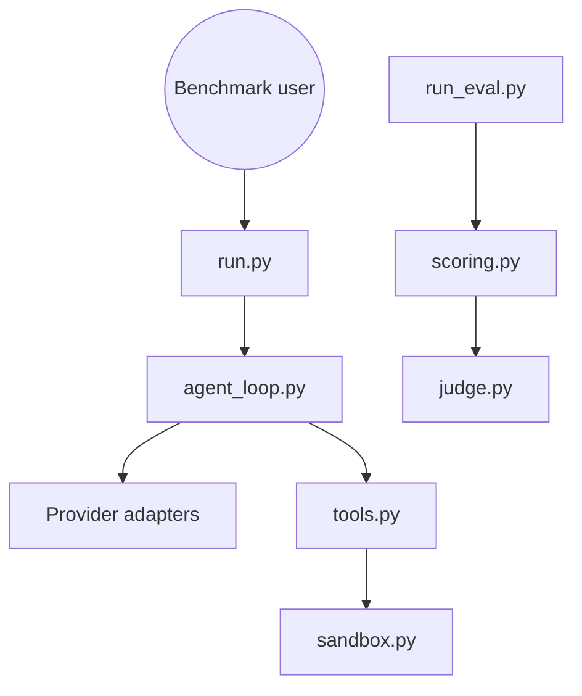

# harveyai/harvey-labs

> Benchmark ouvert pour évaluer des agents LLM sur des tâches juridiques réalistes, pour équipes d'évaluation.

## Le problème
Évaluer des agents sur du vrai travail juridique (dossiers, documents, livrables) manque de jeux de tâches avec grilles de notation réalistes.

## Ce que ça fait vraiment
Deux parties : un jeu de tâches (instructions, documents, rubriques) et un harnais d'exécution. `run.py` charge une tâche, lance une boucle d'agent via un adaptateur de fournisseur, avec des outils de workspace dans un sandbox et un parseur de documents. Un évaluateur note par rubrique « all-pass » avec un juge LLM, produit rapports, comparaisons, graphiques, lecture de trajectoires et balayages de modèles.

## Comment c'est branché

## Essayer
Aucune commande dans le README fourni ; il renvoie à `docs/tutorial.md` (parcours M&A de bout en bout : installation, exécution, notation, rapports).

## Coût et pièges
Les appels aux fournisseurs de modèles et au juge LLM sont à ta charge ; le coût d'un balayage n'est pas documenté dans la matière fournie.

## Ce que ce n'est pas
Pas un agent juridique utilisable : c'est un banc d'essai. Le projet est annoncé comme évolutif, tâches et harnais en construction.

## Alternatives
Aucune citée dans le README.

## Pour toi
Surveiller : intéressant comme modèle de méthode (rubriques all-pass + juge LLM) pour évaluer des agents, même hors juridique.

