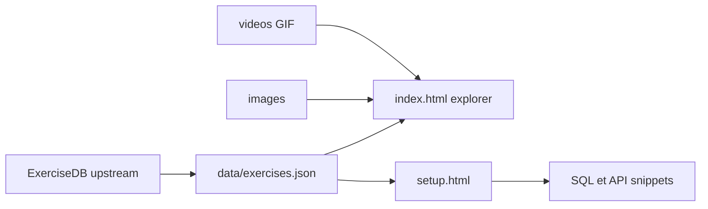

# hasaneyldrm/exercises-dataset

> Dataset of 1,324 strength-training exercises with GIFs, thumbnails and instructions in ten languages.

## The problem
Building a fitness application requires structured exercise data with visuals and translations, which are hard to gather.

## What it actually does
A `data/exercises.json` file of 1,324 entries (category, body part, equipment, target, secondary muscles, instruction steps in 10 languages) and a JSON schema. Each exercise has a 180×180 thumbnail and an animated GIF. Two standalone HTML pages: an exercise browser (`index.html`) and an integration guide (`setup.html`) that generates SQL and API examples.

## How it is wired


## Trying it
```python
import json

with open("data/exercises.json", "r", encoding="utf-8") as f:
    exercises = json.load(f)

chest_exercises = [ex for ex in exercises if ex["category"] == "chest"]
```

## Cost and gotchas
Free, nothing to install. The media are © Gym visual, with their own terms (NOTICE.md). The README announces MIT for the code and data, but GitHub does not identify the license.

## What it is not
Not a ready-to-use API: it has to be built around the JSON. The media are not royalty-free; commercial use requires reading Gym visual's terms.

## Alternatives
No alternative named in the README.

## For you
Worth watching: a handy source for a training or recommendation prototype, but the rights on the media and the unidentified license must be clarified before any product use.
