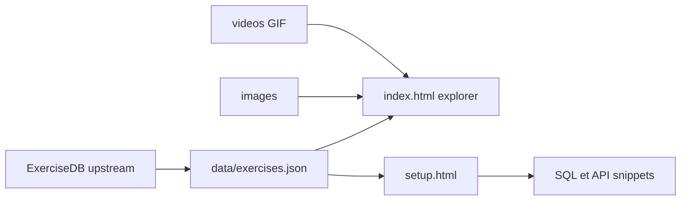

# hasaneyldrm/exercises-dataset

> Jeu de 1 324 exercices de musculation avec GIF, vignettes et instructions en dix langues.

## Le problème
Construire une application de sport demande des données d'exercices structurées avec visuels et traductions, difficiles à rassembler.

## Ce que ça fait vraiment
Un fichier `data/exercises.json` de 1 324 fiches (catégorie, partie du corps, équipement, cible, muscles secondaires, étapes d'instructions en 10 langues) et un schéma JSON. Chaque exercice a une vignette 180×180 et un GIF animé. Deux pages HTML autonomes : un navigateur d'exercices (`index.html`) et un guide d'intégration (`setup.html`) qui génère du SQL et des exemples d'API.

## Comment c'est branché


## Essayer
```python
import json

with open("data/exercises.json", "r", encoding="utf-8") as f:
    exercises = json.load(f)

chest_exercises = [ex for ex in exercises if ex["category"] == "chest"]
```

## Coût et pièges
Gratuit, rien à installer. Les médias sont © Gym visual, avec des conditions propres (NOTICE.md). Le README annonce du MIT pour le code et les données, mais GitHub n'identifie pas la licence.

## Ce que ce n'est pas
Pas une API prête à l'emploi : elle est à construire autour du JSON. Les médias ne sont pas libres de droits ; l'usage commercial exige de lire les termes de Gym visual.

## Alternatives
Aucune alternative nommée dans le README.

## Pour toi
À surveiller : source pratique pour un prototype d'entraînement ou de recommandation, mais les droits sur les médias et la licence non identifiée sont à clarifier avant tout usage produit.

