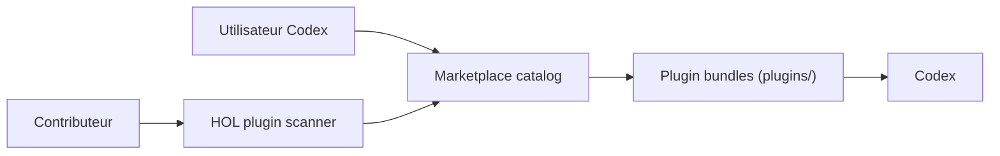

# hashgraph-online/awesome-codex-plugins

> Annotated list of Codex plugins, also usable as a Git marketplace, for anyone extending Codex.

## The problem
Codex plugins (skills, MCP servers, integrations) are scattered and have no quality filter.

## What it actually does
- Lists official plugins (Box, GitHub, Hugging Face, Sentry, Slack…) and more than 200 community ones: workflow, memory, code review, MCP, tools.
- Publishes a Codex marketplace (`.agents/plugins/marketplace.json`) that points to mirror copies under `./plugins/`.
- Requires a score of at least 80/130 from the HOL scanner (plugin-scanner) for admission.
- Offers a registry with trust scores and a "verified" badge.

## How it is wired


## Trying it
```bash
codex plugin marketplace add 'https://github.com/hashgraph-online/awesome-codex-plugins.git' --ref 'main' --sparse '.agents/plugins' --sparse 'plugins'
codex plugin list --source awesome-codex-plugins
codex plugin install <plugin-name> --source awesome-codex-plugins
pipx run plugin-scanner lint .
```

## Cost and gotchas
Free, but some listed plugins require accounts, keys or paid subscriptions (for example LinkMCP, marked as paid). An installed plugin runs with your agent's permissions.

## What it is not
Not a security guarantee: the README states "Scan ≠ safety guarantee" and that the score is published by HOL, not independently validated.

## Alternatives
awesome-ai-plugins (an umbrella list) and the HOL Plugin Registry, both cited in the README.

## For you
Worth watching: handy for spotting MLOps or agent-memory plugins, but audit each plugin before installing it.
