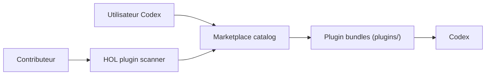

# hashgraph-online/awesome-codex-plugins

> Liste commentée de plugins Codex, utilisable aussi comme marketplace Git, pour qui étend Codex.

## Le problème
Les plugins Codex (skills, serveurs MCP, intégrations) sont dispersés et sans filtre de qualité.

## Ce que ça fait vraiment
- Recense des plugins officiels (Box, GitHub, Hugging Face, Sentry, Slack…) et plus de 200 communautaires : workflow, mémoire, revue de code, MCP, outils.
- Publie un marketplace Codex (`.agents/plugins/marketplace.json`) qui pointe vers des copies miroirs sous `./plugins/`.
- Exige un score ≥ 80/130 du scanner HOL (plugin-scanner) pour être admis.
- Propose un registre avec scores de confiance et un badge « vérifié ».

## Comment c'est branché


## Essayer
```bash
codex plugin marketplace add 'https://github.com/hashgraph-online/awesome-codex-plugins.git' --ref 'main' --sparse '.agents/plugins' --sparse 'plugins'
codex plugin list --source awesome-codex-plugins
codex plugin install <plugin-name> --source awesome-codex-plugins
pipx run plugin-scanner lint .
```

## Coût et pièges
Gratuit, mais certains plugins listés exigent comptes, clés ou abonnements payants (par exemple LinkMCP, indiqué payant). Un plugin installé s'exécute avec les droits de ton agent.

## Ce que ce n'est pas
Pas une garantie de sécurité : le README précise « Scan ≠ safety guarantee » et que le score est publié par HOL, pas validé de façon indépendante.

## Alternatives
awesome-ai-plugins (liste fédératrice) et le HOL Plugin Registry, cités dans le README.

## Pour toi
À surveiller : pratique pour repérer des plugins MLOps ou mémoire d'agent, mais audite chaque plugin avant de l'installer.

