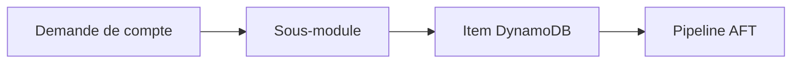

# hashicorp-education/learn-terraform-aft-account-request

> Companion repository to a HashiCorp tutorial on requesting AWS accounts through Control Tower Account Factory for Terraform.

## The problem
Creating AWS accounts in bulk requires a precise structure that the AFT pipeline enforces.

## What it actually does
It contains a baseline configuration for defining account requests destined for the Account Factory for Terraform module. The pipeline requires the repository structure and the provided submodule, which defines a DynamoDB table item with the account specifications.

## How it is wired
Simplified diagram based on the fiche, no diagram provided.



## Trying it
```bash
# Aucune commande dans le README : suivre le tutoriel HashiCorp associé.
```

## Cost and gotchas
It requires an AWS Control Tower environment already in place, not detailed here. Last push in June 2024.

## What it is not
It is not a standalone tool: without the tutorial and AFT, it is useless. The README is very short.

## Alternatives
No alternative named in the README.

## For you
Ignore: Control Tower tutorial support material, unrelated to data / AI work, and inactive for over a year.
