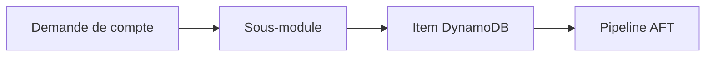

# hashicorp-education/learn-terraform-aft-account-request

> Dépôt compagnon d'un tutoriel HashiCorp pour demander des comptes AWS via Control Tower Account Factory for Terraform.

## Le problème
Créer des comptes AWS à la chaîne exige une structure précise que le pipeline AFT impose.

## Ce que ça fait vraiment
Il contient une configuration de base pour définir des demandes de compte à destination du module Account Factory for Terraform. Le pipeline exige la structure du dépôt et le sous-module fourni, qui définit un item de table DynamoDB avec les spécifications du compte.

## Comment c'est branché
Schéma simplifié d'après la fiche, sans diagramme fourni.



## Essayer
```bash
# Aucune commande dans le README : suivre le tutoriel HashiCorp associé.
```

## Coût et pièges
Il faut un environnement AWS Control Tower déjà en place, non détaillé ici. Dernier push en juin 2024.

## Ce que ce n'est pas
Ce n'est pas un outil autonome : sans le tutoriel et AFT, il ne sert à rien. Le README est très court.

## Alternatives
Aucune alternative nommée dans le README.

## Pour toi
À ignorer : support de tutoriel Control Tower, sans lien avec un travail data / IA, et inactif depuis plus d'un an.

