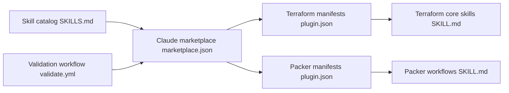

# hashicorp/agent-skills

> Catalog of HashiCorp agent skills for writing Terraform and Packer.

## The problem
Coding agents write Terraform or Packer images without knowing HashiCorp conventions, testing or credential handling.

## What it actually does
Markdown content: 16 Terraform skills (providers, resources, tests, modules, stacks, policy, style) and 4 Packer skills (AWS AMI, Azure image, Windows, registry). Delivered as plugin bundles for Claude Code and Codex, or skill by skill with `npx skills`. No execution, only guidance. A CI workflow validates structure and links.

## How it is wired


## Trying it
```bash
claude plugin marketplace add hashicorp/agent-skills
claude plugin install terraform@hashicorp
npx skills add hashicorp/agent-skills/plugins/terraform/skills/terraform-style-guide
```

## Cost and gotchas
Free. Cloud credentials and execution stay with you. Old plugin IDs replaced by `terraform@hashicorp` and `packer@hashicorp`.

## What it is not
Not a tool that applies or validates your infrastructure: these are instructions for the agent. Third-party client support is not guaranteed.

## Alternatives
No alternative named in the README.

## For you
Worth watching: useful if you do Terraform infrastructure as code with a coding agent; the publisher is a company and the content remains limited to these two tools.
