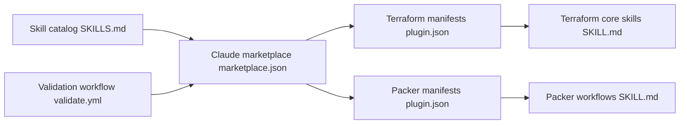

# hashicorp/agent-skills

> Catalogue de skills d'agents HashiCorp pour écrire du Terraform et du Packer.

## Le problème
Les agents de code écrivent du Terraform ou des images Packer sans connaître les conventions HashiCorp, les tests ou la gestion des credentials.

## Ce que ça fait vraiment
Contenu Markdown : 16 skills Terraform (providers, ressources, tests, modules, stacks, policy, style) et 4 skills Packer (AMI AWS, image Azure, Windows, registre). Livrés comme bundles de plugins pour Claude Code et Codex, ou skill par skill avec `npx skills`. Pas d'exécution, seulement du guidage. Un workflow CI valide structure et liens.

## Comment c'est branché


## Essayer
```bash
claude plugin marketplace add hashicorp/agent-skills
claude plugin install terraform@hashicorp
npx skills add hashicorp/agent-skills/plugins/terraform/skills/terraform-style-guide
```

## Coût et pièges
Gratuit. Les credentials cloud et l'exécution restent chez toi. Ancien plugin IDs remplacés par `terraform@hashicorp` et `packer@hashicorp`.

## Ce que ce n'est pas
Pas un outil qui applique ou valide ton infrastructure : ce sont des instructions pour l'agent. Le support des clients tiers n'est pas garanti.

## Alternatives
Aucune alternative nommée dans le README.

## Pour toi
Surveiller : utile si tu fais de l'infra as code Terraform avec un agent de code ; l'éditeur est une entreprise et le contenu reste borné à ces deux outils.

