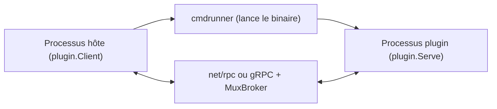

# hashicorp/go-plugin

> Plugin system for Go, via subprocesses and RPC, used by Terraform, Vault, Nomad, Packer.

## The problem
Loading third-party code into the same process crashes it along with that code; Go's `plugin` library has strong limitations.

## What it actually does
The host launches the plugin as a subprocess and communicates via net/rpc or gRPC (so plugins can be in any language). The plugin implements a Go interface as if it were local. Handles complex arguments (MuxBroker), calls in both directions, logging, stdout/stderr synchronization, TTY, protocol versions, reattachment, checksum verification and TLS.

## How it is wired

## Trying it
No documented command: the README describes five steps (interface, RPC client/server, `Plugin`, `plugin.Serve`, `plugin.Client`) and points to the `examples/` folder.

## Cost and gotchas
Free, MPL-2.0. Designed for a reliable local network only. Writing the interface client and server implementations is tedious.

## What it is not
Not a plugin architecture over a remote network. Slower than shared libraries.

## Alternatives
- Go's standard `plugin` package: faster, but with many limitations.

## For you
Worth watching: useful if you write MLOps tools in Go with third-party extensions; off-topic if you stay in Python.
