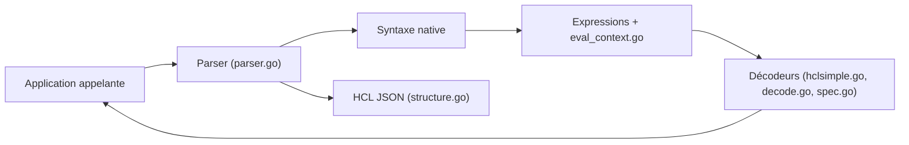

# hashicorp/hcl

> Go library for defining configuration languages that are readable by humans and machines, used by DevOps tools.

## The problem
JSON and YAML serialize data but are not designed as configuration languages: hard to read, with no expressions and poor error messages.

## What it actually does
The application declares the expected attributes and blocks; HCL parses the file (native syntax or an equivalent JSON variant), checks the structure and returns usable objects. It handles expressions, interpolation, variables and functions supplied by the caller. Decoders fill Go structs (`hclsimple.DecodeFile`) or dynamic values; extensions: dynamic blocks, user functions, and writing and formatting that preserve the source. Version 2 is incompatible with version 1.

## How it is wired


## Trying it
```bash
# Exemple Go du README (hclsimple), fichier config.hcl :
# err := hclsimple.DecodeFile("config.hcl", nil, &config)
```

## Cost and gotchas
Free, imported through Go Modules only. MPL-2.0 license: file-level copyleft to be aware of. No migration path from HCL 1 to 2.

## What it is not
Not an end tool: you need a Go application that embeds it (which is what Terraform does, outside the README). Not a universal interchange format like JSON.

## Alternatives
JSON, YAML (compared in the README's "Why?" section).

## For you
Useful only if you write Go tools with rich configuration; for data/AI in Python it brings nothing directly, but understanding HCL helps you read infrastructure configurations.
