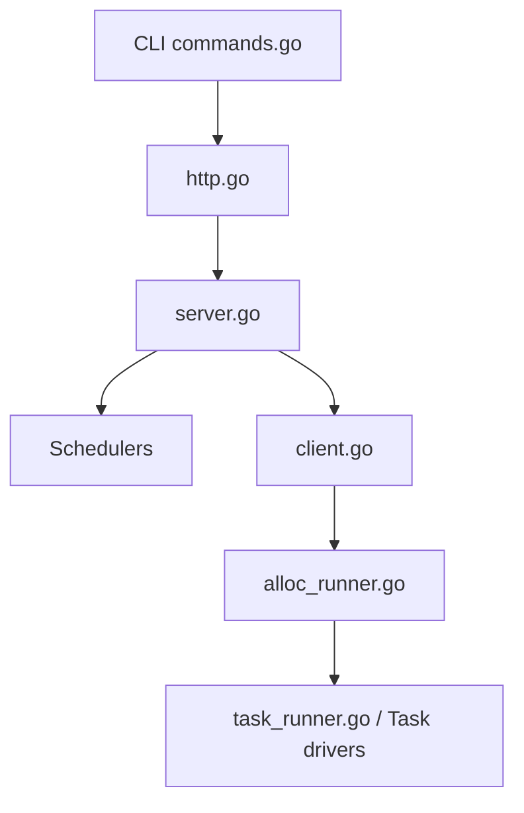

# hashicorp/nomad

> Single-binary orchestrator for containers, binaries and VMs, on-premises or in the cloud.

## The problem
Kubernetes is heavy to operate, especially when containers, legacy applications and batch jobs have to run side by side.

## What it actually does
A single binary bundles scheduling and resource management, with no external storage.
Task drivers support Docker, Podman, executables, Java and QEMU.
Device plugins handle GPU, FPGA and TPU. Federation spans multiple regions.
It integrates with Consul and Vault.

## How it is wired

## Trying it
The README gives no command and points to the Getting Started tutorials.

## Cost and gotchas
A Nomad Enterprise version exists and it is paid. GitHub does not identify the license, so check before any commercial use.

## What it is not
It is not an MLOps tool: it orchestrates, it does not track experiments or models. The documentation lives in another repository (`web-unified-docs`).

## Alternatives
The README names no alternative repository.

## For you
Ignore: it is general-purpose infrastructure. Useful only if your team is looking for a lightweight alternative to Kubernetes for GPU batch jobs.
