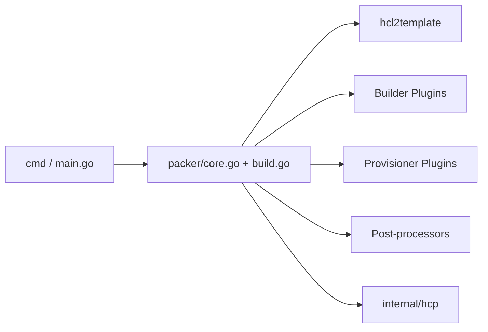

# hashicorp/packer

> Tool that builds identical machine images for several platforms from a single configuration.

## The problem
Machine images built by hand, or differently per platform, drift and cannot be reproduced.

## What it actually does
A Go binary that reads a template (HCL) and triggers builders, provisioners, data sources and post-processors in parallel, supplied as external plugins downloaded by a "plugin getter". An HCP Packer integration records image metadata. Images can become Vagrant boxes.

## How it is wired

## Trying it
No command in the README: it points to the Docker and AWS guides in the documentation.

## Cost and gotchas
The target platforms (AWS, etc.) bill you. A license is present but not identified by GitHub. Some community plugins are unmaintained or archived.

## What it is not
It is not a deployment orchestrator: it produces images. HCP Packer is a separate service.

## Alternatives
No alternative named in the README (Terraform is mentioned as a consumer of the HCP metadata).

## For you
Worth watching: useful for freezing reproducible GPU or training images, provided the license is checked.
